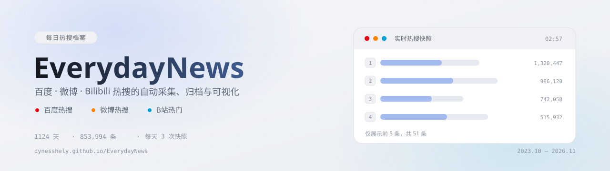
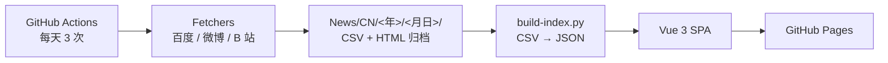

<picture>
  <source media="(prefers-color-scheme: dark)" srcset="assets/banner-dark.svg">
  <source media="(prefers-color-scheme: light)" srcset="assets/banner-light.svg">
  
</picture>

<p align="center">
  <a href="https://github.com/Dynesshely/EverydayNews/actions/workflows/build-web.yml"></a>
  <a href="https://dynesshely.github.io/EverydayNews/"></a>
  <a href="https://github.com/Dynesshely/EverydayNews/stargazers"></a>
  <a href="https://github.com/Dynesshely/EverydayNews/network/members"></a>
  <a href="https://github.com/Dynesshely/EverydayNews/commits/main"></a>
  <a href="./LICENSE"></a>
</p>

<p align="center">
  
  
  
  
  
  
</p>

## 概览

**EverydayNews** 是一个面向中文互联网热搜榜的自动化归档项目：每天定时抓取 **百度热搜 / 微博热搜 / B 站热门视频**，把每次快照以 CSV 落进 Git 仓库，再由前端构建脚本转成 JSON，最终以 SPA 的形式提供浏览、检索与趋势回看。

它想解决的问题很简单——热搜是**易逝**的。榜单刷新之后，当天上过什么、排到第几、热度多少，就没有地方能完整查到了。这里把「每小时都在变」的东西固化成可按天翻阅的档案。

| 项目 | 数据 |
| --- | --- |
| 采集频率 | 每天 3 次（北京时间 06:00 / 12:00 / 20:00） |
| 覆盖日期 | 2023-10-16 起，已归档 **1124 天** |
| 条目总量 | **853,994 条**（百度 ~50 + 微博 ~50 + B 站 200 / 次） |
| 数据格式 | 原始归档 CSV，前端数据 JSON |

**主要功能**

- **首页概览**：最新日期的三个平台榜单卡片，百度 / 微博展示各时段 Top 5，B 站展示封面网格
- **日期浏览**：按天翻看历史快照，仅开放有数据的日期
- **平台筛选**：全部 / 百度 / 微博 / B 站分栏，单平台视图展示全量条目
- **全文检索**：基于 Fuse.js 的客户端模糊搜索，结果按日期与匹配度排序
- **趋势回看**：点任意标题查看该话题在历史快照中的排名变化（ECharts）
- **亮 / 暗主题**：跟随系统或手动切换，线性图表与表格配色同步

> 在线地址：<https://dynesshely.github.io/EverydayNews/>

## 部署

站点通过 **GitHub Pages** 托管，全部构建流程跑在 GitHub Actions 上，仓库本身不存构建产物。



| 工作流 | 触发方式 | 职责 |
| --- | --- | --- |
| [`launcher-cn.yml`](.github/workflows/launcher-cn.yml) | 定时（`0 4,12,22 * * *` UTC） | 并行调用三个抓取工作流，再把结果合并回 `main` |
| [`fetcher-*.yml`](.github/workflows) | 由 launcher 调用 / 手动 | 单个平台抓取，提交到 `fetch=<平台>` 分支 |
| [`build-web.yml`](.github/workflows/build-web.yml) | push `main` / launcher 完成 / 手动 | 生成 JSON、构建 SPA、发布到 Pages |

一次完整发布包含三步：

1. **抓取**：三个 fetcher 各自拉取榜单，结果提交到独立分支（`fetch=baidu-hot-search` 等），互不干扰；
2. **合并**：`launcher-cn` 把三个分支合并回 `main`，形成按日期组织的 Git 历史归档；
3. **构建**：`build-web` 运行 `Web/scripts/build-index.py` 把 CSV 转成 JSON，`pnpm build` 产出静态站点，部署到 Pages。

站点使用 `/EverydayNews/` 作为 base path（见 `Web/vite.config.ts`），本地开发与线上路径一致。

## 开发

**前置依赖**

| 依赖 | 版本 | 说明 |
| --- | --- | --- |
| Node.js | ≥ 22 | 前端构建 |
| pnpm | ≥ 9 | 包管理器（CI 用 pnpm） |
| Python | ≥ 3.10 | 数据预处理；抓取脚本另需 `requests` / `pandas`，微博需要 `selenium` + `bs4` |

```bash
cd Web

# 1) 安装依赖
pnpm install

# 2) CSV → JSON（数据量大，首次约需 1~3 分钟）
python scripts/build-index.py

# 3) 启动开发服务器（http://localhost:52611/EverydayNews/）
pnpm dev

# 4) 生产构建（含 vue-tsc 类型检查）
pnpm build
```

**注意事项**

- `Web/public/data/` 是 `build-index.py` 的产物，**不入库**（见 `.gitignore`），拉仓库后必须先跑一次生成脚本，否则页面无数据。
- 开发服务器固定端口 `52611`，并且只监听 `::1`：访问请用 `localhost`，不要用 `127.0.0.1`。
- 抓取脚本位于 `Fetchers/CN/`，需要访问百度 / 微博 / B 站线上接口；微博走 Selenium，需要本机有 Chrome 与对应 chromedriver。
- 单个抓取脚本都可以独立运行，产物直接落到 `News/CN/<年>/<月日>/`，例如：

```bash
cd Fetchers/CN
python fetcher-baidu-hot-search-v2.py
```

## 架构

### 数据管线

```
采集 ──► 归档 ──► 归一化 ──► 前端
CSV      Git        JSON        SPA
```

**1. 采集（`Fetchers/CN/`）**

| 平台 | 脚本 | 来源 | 方式 | 单次条数 |
| --- | --- | --- | --- | --- |
| 百度热搜 | `fetcher-baidu-hot-search-v2.py` | `top.baidu.com` API | HTTP GET + JSON 解析 | ~50 |
| 微博热搜 | `fetcher-weibo-hot-search.py` | `s.weibo.com/top/summary` | Selenium + BeautifulSoup | ~50 |
| B 站热门 | `fetcher-bilibili-hot-videos.py` | `api.bilibili.com` 热门接口 | HTTP GET 分页（×10 页） | 200 |

**2. 归档（`News/CN/`）**

```
News/CN/{YYYY}/{MMDD}/
├── 百度热搜榜.{minutes}.csv / .html
├── 微博热搜榜.{minutes}.csv / .html
└── BiliBili 热门视频.{minutes}.csv
```

`{minutes}` 是抓取时刻在当天的分钟序号（北京时间 `hour * 60 + minute`），例如 `1200` 表示 20:00。归档文件**只增不改**，历史快照永不被覆写。

**3. 归一化（`Web/scripts/build-index.py`）**

扫描全部 CSV，按表头识别平台与版本（百度有 v1/v2 两代格式），归一化成统一的 `NewsItem`，输出三组 JSON：

| 产物 | 内容 | 用途 |
| --- | --- | --- |
| `data/index.json` | 日期 → 平台 → 采集时刻列表 | 首屏加载，驱动日期选择器 |
| `data/meta.json` | 日期范围、天数、条目总数等统计 | 页头信息 |
| `data/day/{date}-{platform}.json` | 单天单平台的全部快照与条目 | 按需懒加载 |
| `data/search/{platform}/{chunk}.json` | 检索索引分块（微博/百度按年，B 站按月） | Fuse.js 客户端检索 |

构建期还会做两件事：

- **链接自愈**：历史微博归档存在抓取端 off-by-one（标题与链接错位一行），且部分置顶/广告行的 `href` 是 `javascript:void(0)`。构建时按「链接参数与哪一行标题一致」判定错位方向，重对齐后逐行校验，无法还原的置空，前端自动降级为纯文本，避免点错页面。
- **单位解析**：微博热度形如 `电影 559962`（带分类前缀），需取其中的数值部分。

### 数据结构

**原始 CSV（各平台表头不同，构建时归一化）**

```text
百度 v1（2023—2024）: 热搜排名, 热搜标题, 描述, 热搜指数, 链接地址, 封图链接
百度 v2（2025 起）  : 热搜排名, 热搜标题, 标签, 是否置顶, 链接地址, 热度类型
微博                : 排名, 标题, 链接, 热点
B 站                : 视频 ID, 用户 ID, 用户昵称, 标题, 归属类别, 图片, 发布时间,
                      观看人数, 弹幕数, 点赞数, 投币数, 收藏数, 分享数, 评论数, 当前时间
```

**归一化后的 JSON**

```ts
type NewsItem = BaiduNewsItem | WeiboNewsItem | BilibiliNewsItem

// 百度：v1 带 desc / heatScore / image，v2 带 tag / isTop / heatType
{ platform: 'baidu', version: 'v1' | 'v2', rank, title, url, desc?, heatScore?, image?, tag?, isTop?, heatType? }

// 微博
{ platform: 'weibo', version: 'v1', rank, title, url, hotness }

// B 站
{ platform: 'bilibili', version: 'v1', rank, title, url, videoId, nickname, category,
  image, publishTime, views, danmaku, likes, coins, favorites, shares, comments }

// 单天单平台的快照集合
{ date: 'YYYYMMDD', platform: 'baidu' | 'weibo' | 'bilibili',
  snapshots: [{ minutes, captureTime: 'HH:mm', items: NewsItem[] }] }
```

### 前端结构

```text
Web/
├── scripts/build-index.py       CSV → JSON 预处理
├── public/data/                 生成的数据（不入库）
└── src/
    ├── api/loader.ts            带缓存的 JSON 加载器
    ├── stores/app.ts            Pinia：日期 / 平台 / 主题 / 数据加载
    ├── types/index.ts           NewsItem 等类型定义
    ├── utils/format.ts          日期、数字、平台名格式化
    ├── components/
    │   ├── AppHeader.vue        品牌头 + 统计 + 主题切换
    │   ├── PlatformTabs.vue     平台切换
    │   ├── DateNavigator.vue    日期选择（仅开放有数据的日期）
    │   ├── SearchPanel.vue      Fuse.js 检索面板
    │   ├── DayView.vue          首页 / 单平台的编排层
    │   ├── SnapshotTimeline.vue 多快照网格布局
    │   ├── SnapshotCard.vue     百度和微博的榜单表格（宽度自适应）
    │   ├── BilibiliGrid.vue     B 站封面网格
    │   ├── TrendChart.vue       排名变化趋势（ECharts）
    │   └── ...
    └── assets/main.css          Tailwind 主题变量（亮 / 暗）
```

| 层 | 选型 |
| --- | --- |
| 框架 | Vue 3 + Vite + TypeScript |
| UI 组件 | Naive UI |
| 样式 | Tailwind CSS 4 |
| 状态管理 | Pinia |
| 检索 | Fuse.js（客户端分块加载） |
| 图表 | ECharts + vue-echarts |
| 图标 | @vicons/carbon |
| 工具 | @vueuse/core |

## Star History

<a href="https://star-history.com/#Dynesshely/EverydayNews&Date">
  <picture>
    <source media="(prefers-color-scheme: dark)" srcset="https://api.star-history.com/svg?repos=Dynesshely/EverydayNews&type=Date&theme=dark">
    
  </picture>
</a>

## 许可证

本项目采用 [MIT 许可证](LICENSE)。

> 仓库内 `News/` 下的热搜数据仅用于归档与研究，版权归原平台及原作者所有；引用或再分发前请自行确认合规性。
